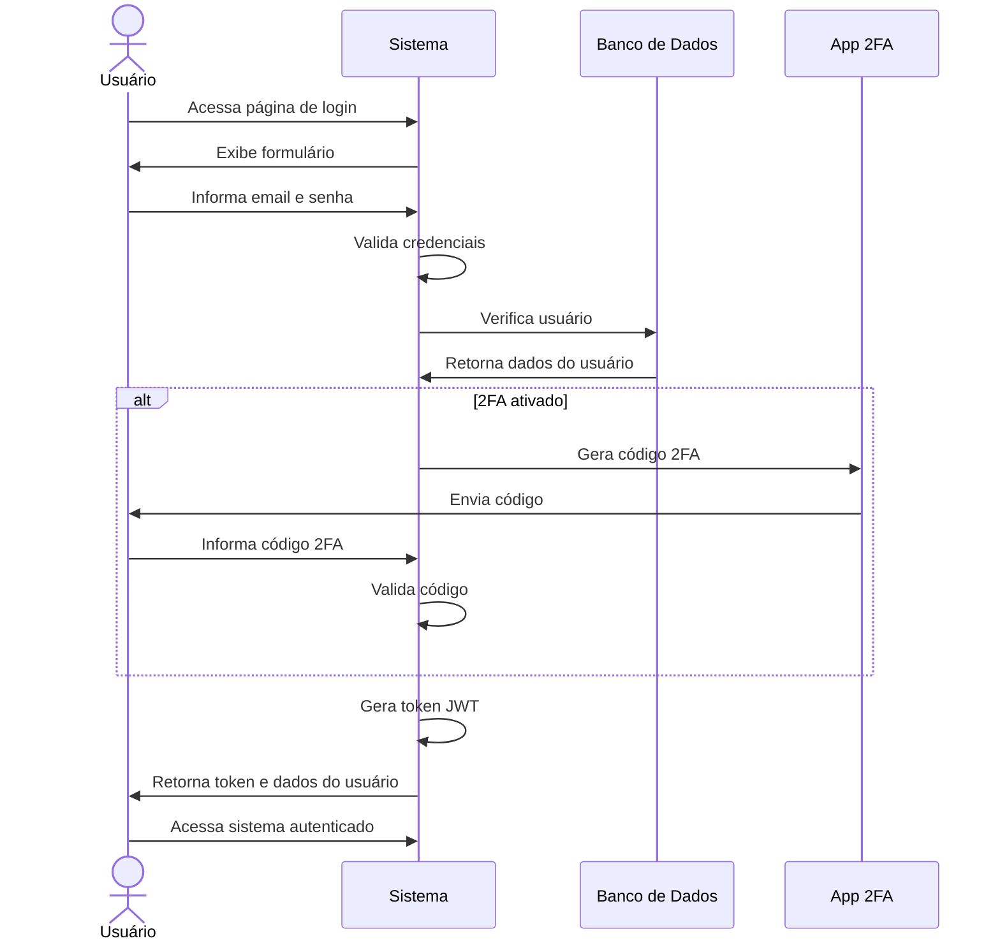

# RF002 🔑 Login com email/senha e autenticação multifator (2FA)

## 📝 Descrição

Esta funcionalidade permite que usuários façam login no sistema Metakyasshu usando email/senha e autenticação multifator para maior segurança.

## 👥 Atores

- 👤 Usuário cadastrado

## ⚠️ Pré-condições

- O usuário deve estar cadastrado no sistema
- O email deve estar confirmado
- O usuário deve ter configurado 2FA (opcional)

## 🔌 Endpoints

- `POST /api/auth/login`
- `POST /api/auth/2fa/verify`

## 📋 Dados de Login

| Campo      | Tipo     | Obrigatório | Descrição         | Restrições             |
|------------|----------|-------------|-------------------|------------------------|
| `email`    | `string` | ✅ Sim       | E-mail do usuário | Formato válido         |
| `password` | `string` | ✅ Sim       | Senha do usuário  | Mínimo de 8 caracteres |
| `code2fa`  | `string` | ❌ Não       | Código 2FA        | 6 dígitos numéricos    |

## 🔄 Fluxo Principal



1. O usuário acessa a página de login do sistema.
2. O sistema exibe o formulário de login com campos para email e senha.
3. O usuário informa seu email e senha.
4. O sistema valida as credenciais informadas.
5. O sistema verifica se o usuário existe e está ativo.
6. Se o 2FA estiver ativado, o sistema gera um código de verificação.
7. O código é enviado para o aplicativo 2FA do usuário.
8. O usuário informa o código 2FA recebido.
9. O sistema valida o código 2FA.
10. O sistema gera um token JWT de autenticação.
11. O sistema retorna o token e os dados do usuário.
12. O usuário é redirecionado para o dashboard principal.

## 🔀 Fluxos Alternativos

### ⚠️ FA01 - Login sem 2FA

1. O usuário acessa a página de login do sistema.
2. O sistema exibe o formulário de login.
3. O usuário informa email e senha.
4. O sistema valida as credenciais.
5. O sistema verifica que o 2FA não está ativado.
6. O sistema gera token JWT diretamente.
7. O usuário é autenticado e redirecionado.

### ⚠️ FA02 - Recuperação de acesso 2FA

1. O usuário informa que perdeu acesso ao 2FA.
2. O sistema solicita verificação adicional (email/SMS).
3. O usuário confirma a verificação.
4. O sistema desativa temporariamente o 2FA.
5. O usuário pode fazer login normalmente.
6. O sistema solicita reconfiguração do 2FA.

## 🚫 Fluxos de Exceção

### ⚠️ FE01 - Credenciais inválidas

1. No passo 4 do fluxo principal, se as credenciais forem inválidas, o sistema exibe mensagem de erro.
2. O sistema retorna ao passo 2 do fluxo principal.

### ⚠️ FE02 - Usuário inativo

1. No passo 5 do fluxo principal, se o usuário estiver inativo, o sistema exibe mensagem de erro.
2. O sistema solicita reativação da conta.

### ⚠️ FE03 - Código 2FA inválido

1. No passo 9 do fluxo principal, se o código 2FA for inválido, o sistema exibe mensagem de erro.
2. O sistema permite nova tentativa de inserção do código.

### ⚠️ FE04 - Muitas tentativas de login

1. Se houver muitas tentativas de login, o sistema bloqueia temporariamente o acesso.
2. O sistema solicita verificação adicional ou aguarda tempo de bloqueio.

## 🧪 Exemplos de Uso

### Requisição de Login

```http
POST /api/auth/login HTTP/1.1
Host: api.metakyasshu.com
Content-Type: application/json

{
  "email": "joao@email.com",
  "password": "Senha@123"
}
```

### Resposta com 2FA Necessário

```json
{
  "success": true,
  "message": "2FA necessário",
  "data": {
    "requires2FA": true,
    "sessionId": "abc123",
    "expiresAt": "2024-12-20T10:30:00Z"
  }
}
```

### Verificação 2FA

```http
POST /api/auth/2fa/verify HTTP/1.1
Host: api.metakyasshu.com
Content-Type: application/json

{
  "sessionId": "abc123",
  "code": "123456"
}
```

### Resposta de Sucesso

```json
{
  "success": true,
  "message": "Login realizado com sucesso",
  "data": {
    "token": "eyJhbGciOiJIUzI1NiIsInR5cCI6IkpXVCJ9...",
    "user": {
      "id": "12345",
      "name": "João Silva",
      "email": "joao@email.com"
    },
    "expiresAt": "2024-12-21T10:30:00Z"
  }
}
```

---

> ---------------------------------------------------------------------------
> #### 💰 METAKYASSHU 💰
> ***Transformando finanças em conquistas compartilhadas***
> --------------------------------------------------------------------------- 