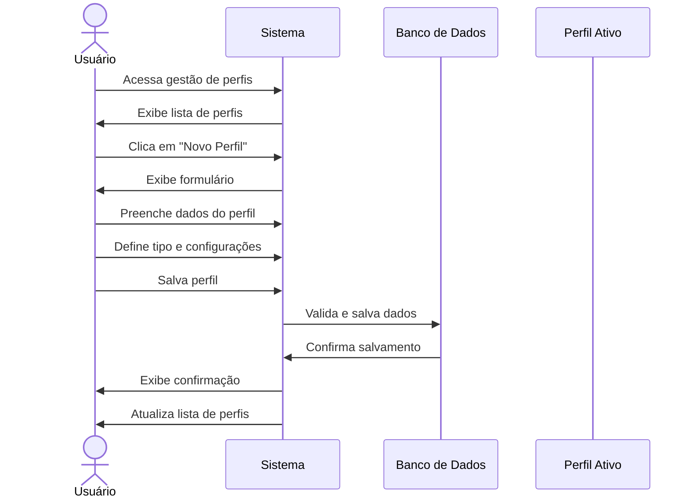

# RF003 👥 Criação e gestão de múltiplos perfis por usuário

## 📝 Descrição

Esta funcionalidade permite que usuários criem e gerenciem múltiplos perfis dentro do sistema Metakyasshu, facilitando a organização de finanças pessoais, familiares e profissionais.

## 👥 Atores

- 👤 Usuário autenticado
- 👥 Membro de grupo (se aplicável)

## ⚠️ Pré-condições

- O usuário deve estar autenticado no sistema
- O usuário deve ter permissão para criar perfis

## 🔌 Endpoints

- `POST /api/profiles`
- `GET /api/profiles`
- `PUT /api/profiles/{id}`
- `DELETE /api/profiles/{id}`
- `POST /api/profiles/{id}/switch`

## 📋 Dados do Perfil

| Campo           | Tipo     | Obrigatório | Descrição                    | Restrições                    |
|-----------------|----------|-------------|------------------------------|-------------------------------|
| `name`          | `string` | ✅ Sim       | Nome do perfil               | Máximo 50 caracteres          |
| `description`   | `text`   | ❌ Não       | Descrição do perfil          | Máximo 200 caracteres         |
| `type`          | `string` | ✅ Sim       | Tipo de perfil               | personal, family, business    |
| `avatar`        | `file`   | ❌ Não       | Avatar do perfil             | Formato de imagem             |
| `color`         | `string` | ❌ Não       | Cor de identificação         | Código hexadecimal            |
| `isDefault`     | `boolean`| ❌ Não       | Perfil padrão                | Padrão: false                 |
| `settings`      | `object` | ❌ Não       | Configurações específicas    | Objeto JSON                   |
| `permissions`   | `array`  | ❌ Não       | Permissões específicas       | Lista de permissões           |

## 🔄 Fluxo Principal



1. O usuário acessa a seção de gestão de perfis do sistema.
2. O sistema exibe a lista de perfis existentes do usuário.
3. O usuário clica em "Criar Novo Perfil".
4. O sistema exibe o formulário de criação de perfil.
5. O usuário preenche os dados obrigatórios (nome e tipo).
6. O usuário pode adicionar descrição, avatar e cor de identificação.
7. O usuário define configurações específicas do perfil.
8. O usuário salva o perfil.
9. O sistema valida os dados informados.
10. O sistema salva o perfil no banco de dados.
11. O sistema atualiza a lista de perfis do usuário.
12. O sistema exibe mensagem de confirmação.

## 🔀 Fluxos Alternativos

### ⚠️ FA01 - Troca de perfil ativo

1. O usuário seleciona um perfil diferente na lista.
2. O sistema solicita confirmação da troca.
3. O usuário confirma a troca de perfil.
4. O sistema salva o perfil ativo na sessão.
5. O sistema redireciona para o dashboard do novo perfil.
6. O sistema atualiza a interface com dados do novo perfil.

### ⚠️ FA02 - Perfil compartilhado com grupo

1. O usuário cria um perfil do tipo "family" ou "business".
2. O sistema solicita informações sobre membros do grupo.
3. O usuário adiciona membros ao perfil.
4. O sistema define permissões para cada membro.
5. O sistema notifica os membros sobre o novo perfil.

### ⚠️ FA03 - Configurações específicas por perfil

1. O usuário acessa configurações do perfil.
2. O sistema exibe opções específicas do tipo de perfil.
3. O usuário define moeda padrão, categorias, alertas.
4. O usuário salva as configurações.
5. O sistema aplica as configurações ao perfil.

## 🚫 Fluxos de Exceção

### ⚠️ FE01 - Limite de perfis atingido

1. Se o usuário tentar criar mais perfis que o limite permitido, o sistema exibe mensagem de erro.
2. O sistema informa o limite atual e sugere upgrade de plano.
3. O usuário pode deletar perfis existentes ou fazer upgrade.

### ⚠️ FE02 - Nome de perfil duplicado

1. Se o usuário informar um nome já existente, o sistema exibe mensagem de erro.
2. O sistema sugere nomes alternativos.
3. O usuário pode escolher um nome diferente.

### ⚠️ FE03 - Perfil em uso não pode ser deletado

1. Se o usuário tentar deletar o perfil ativo, o sistema exibe aviso.
2. O sistema solicita troca para outro perfil primeiro.
3. O usuário deve trocar de perfil antes de deletar.

### ⚠️ FE04 - Erro no upload de avatar

1. Se houver erro no upload do avatar, o sistema exibe mensagem de erro.
2. O sistema permite continuar sem avatar ou nova tentativa.
3. O usuário pode prosseguir sem avatar.

## 🧪 Exemplos de Uso

### Requisição de Novo Perfil

```http
POST /api/profiles HTTP/1.1
Host: api.metakyasshu.com
Authorization: Bearer {token}
Content-Type: application/json

{
  "name": "Finanças Pessoais",
  "description": "Controle das minhas finanças pessoais",
  "type": "personal",
  "color": "#4CAF50",
  "isDefault": true,
  "settings": {
    "currency": "BRL",
    "language": "pt-BR",
    "notifications": true
  }
}
```

### Resposta de Sucesso

```json
{
  "success": true,
  "message": "Perfil criado com sucesso",
  "data": {
    "id": "profile123",
    "name": "Finanças Pessoais",
    "type": "personal",
    "color": "#4CAF50",
    "isDefault": true,
    "createdAt": "2024-12-20T12:30:00Z",
    "settings": {
      "currency": "BRL",
      "language": "pt-BR",
      "notifications": true
    }
  }
}
```

### Troca de Perfil Ativo

```http
POST /api/profiles/profile123/switch HTTP/1.1
Host: api.metakyasshu.com
Authorization: Bearer {token}
```

```json
{
  "success": true,
  "message": "Perfil alterado com sucesso",
  "data": {
    "activeProfile": {
      "id": "profile123",
      "name": "Finanças Pessoais",
      "type": "personal"
    },
    "redirectTo": "/dashboard"
  }
}
```

### Lista de Perfis

```http
GET /api/profiles HTTP/1.1
Host: api.metakyasshu.com
Authorization: Bearer {token}
```

```json
{
  "profiles": [
    {
      "id": "profile123",
      "name": "Finanças Pessoais",
      "type": "personal",
      "color": "#4CAF50",
      "isDefault": true,
      "isActive": true
    },
    {
      "id": "profile456",
      "name": "Casa",
      "type": "family",
      "color": "#2196F3",
      "isDefault": false,
      "isActive": false
    }
  ]
}
```

---

> ---------------------------------------------------------------------------
> #### 💰 METAKYASSHU 💰
> ***Transformando finanças em conquistas compartilhadas***
> --------------------------------------------------------------------------- 