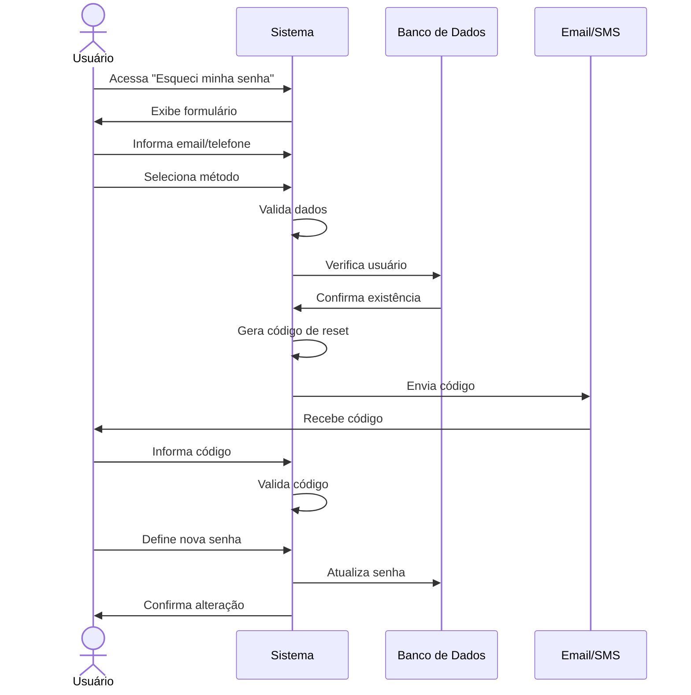

# RF004 🔄 Recuperação de senha via email/SMS

## 📝 Descrição

Esta funcionalidade permite que usuários recuperem acesso à sua conta no sistema Metakyasshu através de verificação por email ou SMS, garantindo segurança e facilidade de uso.

## 👥 Atores

- 👤 Usuário que esqueceu a senha
- 📧 Serviço de Email
- 📱 Serviço de SMS

## ⚠️ Pré-condições

- O usuário deve estar cadastrado no sistema
- O email/telefone deve estar confirmado na conta
- Os serviços de email/SMS devem estar operacionais

## 🔌 Endpoints

- `POST /api/auth/forgot-password`
- `POST /api/auth/reset-password`
- `POST /api/auth/verify-reset-code`
- `POST /api/auth/resend-reset-code`

## 📋 Dados de Recuperação

| Campo           | Tipo     | Obrigatório | Descrição                    | Restrições                    |
|-----------------|----------|-------------|------------------------------|-------------------------------|
| `email`         | `string` | ✅ Sim       | Email do usuário             | Formato válido                |
| `phone`         | `string` | ❌ Não       | Telefone do usuário          | Formato brasileiro            |
| `method`        | `string` | ✅ Sim       | Método de recuperação        | email, sms, both              |
| `resetCode`     | `string` | ✅ Sim       | Código de verificação        | 6 dígitos numéricos           |
| `newPassword`   | `string` | ✅ Sim       | Nova senha                   | Mínimo 8 caracteres           |
| `confirmPassword`| `string` | ✅ Sim       | Confirmação da nova senha    | Deve ser igual à nova senha   |

## 🔄 Fluxo Principal



1. O usuário acessa a página "Esqueci minha senha".
2. O sistema exibe formulário para recuperação.
3. O usuário informa seu email ou telefone cadastrado.
4. O usuário seleciona o método de recuperação (email, SMS ou ambos).
5. O sistema valida os dados informados.
6. O sistema verifica se o usuário existe no banco de dados.
7. O sistema gera um código de recuperação único (6 dígitos).
8. O sistema envia o código via email ou SMS.
9. O usuário recebe o código de recuperação.
10. O usuário informa o código recebido.
11. O sistema valida o código informado.
12. O usuário define uma nova senha.
13. O usuário confirma a nova senha.
14. O sistema atualiza a senha no banco de dados.
15. O sistema invalida todas as sessões ativas.
16. O sistema exibe mensagem de confirmação.
17. O usuário é redirecionado para o login.

## 🔀 Fluxos Alternativos

### ⚠️ FA01 - Recuperação por email

1. O usuário seleciona recuperação por email.
2. O sistema envia email com código de recuperação.
3. O usuário acessa o email e copia o código.
4. O usuário informa o código no sistema.
5. O sistema valida e permite alteração da senha.

### ⚠️ FA02 - Recuperação por SMS

1. O usuário seleciona recuperação por SMS.
2. O sistema envia SMS com código de recuperação.
3. O usuário recebe o SMS e copia o código.
4. O usuário informa o código no sistema.
5. O sistema valida e permite alteração da senha.

### ⚠️ FA03 - Recuperação por ambos os métodos

1. O usuário seleciona ambos os métodos.
2. O sistema envia código por email e SMS.
3. O usuário pode usar qualquer um dos códigos.
4. O sistema valida o primeiro código correto informado.
5. O sistema permite alteração da senha.

## 🚫 Fluxos de Exceção

### ⚠️ FE01 - Usuário não encontrado

1. Se o email/telefone não estiver cadastrado, o sistema exibe mensagem genérica.
2. O sistema não revela se o usuário existe ou não por segurança.
3. O sistema sugere verificar os dados informados.

### ⚠️ FE02 - Código inválido

1. Se o código informado for inválido, o sistema exibe mensagem de erro.
2. O sistema permite nova tentativa de inserção do código.
3. Após 3 tentativas incorretas, o sistema bloqueia temporariamente.

### ⚠️ FE03 - Código expirado

1. Se o código estiver expirado (15 minutos), o sistema exibe mensagem de erro.
2. O sistema permite solicitar novo código.
3. O usuário pode solicitar reenvio do código.

### ⚠️ FE04 - Senha muito fraca

1. Se a nova senha não atender aos critérios de segurança, o sistema exibe erro.
2. O sistema informa os requisitos mínimos de senha.
3. O usuário deve definir uma senha mais forte.

### ⚠️ FE05 - Erro no envio de email/SMS

1. Se houver erro no envio, o sistema exibe mensagem de erro.
2. O sistema sugere tentar outro método de recuperação.
3. O sistema registra o erro para análise.

## 🧪 Exemplos de Uso

### Solicitação de Recuperação

```http
POST /api/auth/forgot-password HTTP/1.1
Host: api.metakyasshu.com
Content-Type: application/json

{
  "email": "joao@email.com",
  "method": "email"
}
```

### Resposta de Solicitação

```json
{
  "success": true,
  "message": "Código de recuperação enviado para seu email",
  "data": {
    "method": "email",
    "email": "jo***@email.com",
    "expiresAt": "2024-12-20T12:45:00Z"
  }
}
```

### Verificação do Código

```http
POST /api/auth/verify-reset-code HTTP/1.1
Host: api.metakyasshu.com
Content-Type: application/json

{
  "email": "joao@email.com",
  "resetCode": "123456"
}
```

### Definição de Nova Senha

```http
POST /api/auth/reset-password HTTP/1.1
Host: api.metakyasshu.com
Content-Type: application/json

{
  "email": "joao@email.com",
  "resetCode": "123456",
  "newPassword": "NovaSenha@123",
  "confirmPassword": "NovaSenha@123"
}
```

### Resposta de Sucesso

```json
{
  "success": true,
  "message": "Senha alterada com sucesso",
  "data": {
    "email": "joao@email.com",
    "passwordChangedAt": "2024-12-20T12:30:00Z",
    "sessionsInvalidated": true
  }
}
```

### Reenvio de Código

```http
POST /api/auth/resend-reset-code HTTP/1.1
Host: api.metakyasshu.com
Content-Type: application/json

{
  "email": "joao@email.com",
  "method": "email"
}
```

---

> ---------------------------------------------------------------------------
> #### 💰 METAKYASSHU 💰
> ***Transformando finanças em conquistas compartilhadas***
> --------------------------------------------------------------------------- 