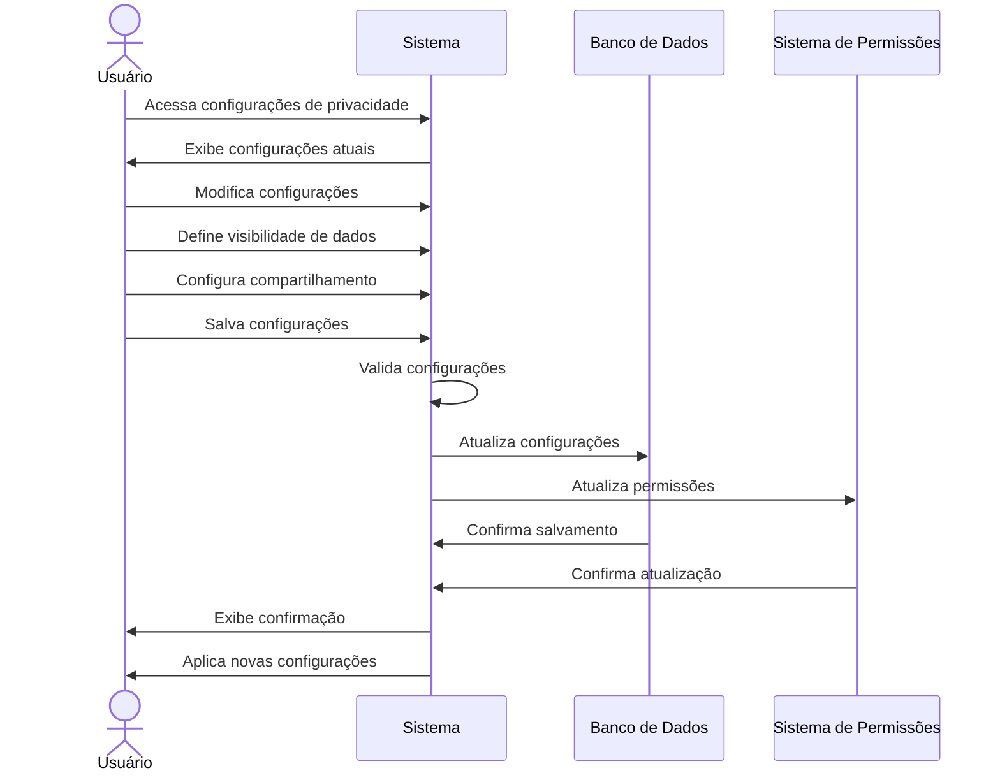

# RF005 🔒 Configurações de privacidade granulares para dados pessoais

## 📝 Descrição

Esta funcionalidade permite que usuários configurem níveis detalhados de privacidade para seus dados pessoais no sistema Metakyasshu, controlando quem pode visualizar e acessar informações específicas.

## 👥 Atores

- 👤 Usuário autenticado
- 👥 Membro de grupo (se aplicável)
- 🔐 Sistema de permissões

## ⚠️ Pré-condições

- O usuário deve estar autenticado no sistema
- O usuário deve ter permissão para alterar configurações de privacidade

## 🔌 Endpoints

- `GET /api/privacy/settings`
- `PUT /api/privacy/settings`
- `POST /api/privacy/settings/reset`
- `GET /api/privacy/audit-log`

## 📋 Configurações de Privacidade

| Campo                    | Tipo     | Obrigatório | Descrição                    | Restrições                    |
|--------------------------|----------|-------------|------------------------------|-------------------------------|
| `profileVisibility`      | `string` | ✅ Sim       | Visibilidade do perfil       | public, friends, private      |
| `financialDataVisibility`| `string` | ✅ Sim       | Visibilidade de dados financeiros | public, friends, private   |
| `expenseSharing`         | `boolean`| ✅ Sim       | Compartilhar despesas        | true/false                   |
| `incomeSharing`          | `boolean`| ✅ Sim       | Compartilhar receitas        | true/false                   |
| `goalSharing`            | `boolean`| ✅ Sim       | Compartilhar metas           | true/false                   |
| `groupDataSharing`       | `object` | ❌ Não       | Compartilhamento por grupo   | Objeto com configurações     |
| `analyticsSharing`       | `boolean`| ✅ Sim       | Compartilhar dados para analytics | true/false              |
| `thirdPartySharing`      | `boolean`| ✅ Sim       | Compartilhar com terceiros   | true/false                   |
| `dataRetention`          | `string` | ✅ Sim       | Retenção de dados            | 1y, 3y, 5y, forever          |
| `exportPermissions`      | `array`  | ❌ Não       | Permissões de exportação     | Lista de permissões           |
| `notificationPrivacy`    | `object` | ❌ Não       | Privacidade de notificações  | Configurações específicas     |

## 🔄 Fluxo Principal



1. O usuário acessa a seção de configurações de privacidade.
2. O sistema exibe as configurações atuais de privacidade do usuário.
3. O usuário visualiza todas as opções de privacidade disponíveis.
4. O usuário modifica as configurações de visibilidade do perfil.
5. O usuário define configurações de compartilhamento de dados financeiros.
6. O usuário configura permissões de compartilhamento por grupo.
7. O usuário define configurações de retenção de dados.
8. O usuário configura permissões de exportação.
9. O usuário define configurações de privacidade de notificações.
10. O usuário salva as configurações de privacidade.
11. O sistema valida todas as configurações informadas.
12. O sistema atualiza as configurações no banco de dados.
13. O sistema atualiza o sistema de permissões.
14. O sistema aplica as novas configurações imediatamente.
15. O sistema exibe mensagem de confirmação.

## 🔀 Fluxos Alternativos

### ⚠️ FA01 - Configurações por grupo

1. O usuário seleciona configurações específicas para um grupo.
2. O sistema exibe opções de privacidade para dados do grupo.
3. O usuário define quem pode ver dados do grupo.
4. O usuário configura permissões específicas por membro.
5. O sistema aplica configurações apenas para o grupo selecionado.

### ⚠️ FA02 - Configurações por tipo de dado

1. O usuário seleciona um tipo específico de dado (despesas, receitas, metas).
2. O sistema exibe configurações específicas para o tipo selecionado.
3. O usuário define visibilidade específica para o tipo de dado.
4. O usuário configura exceções e regras especiais.
5. O sistema aplica configurações apenas para o tipo selecionado.

### ⚠️ FA03 - Restauração de configurações padrão

1. O usuário clica em "Restaurar Padrões".
2. O sistema exibe aviso sobre a restauração.
3. O usuário confirma a restauração.
4. O sistema restaura todas as configurações para os valores padrão.
5. O sistema aplica as configurações padrão.

## 🚫 Fluxos de Exceção

### ⚠️ FE01 - Configurações conflitantes

1. Se o usuário definir configurações que conflitam entre si, o sistema exibe aviso.
2. O sistema destaca os conflitos encontrados.
3. O usuário deve resolver os conflitos antes de salvar.

### ⚠️ FE02 - Permissões insuficientes

1. Se o usuário tentar alterar configurações sem permissão, o sistema exibe erro.
2. O sistema informa quais permissões são necessárias.
3. O usuário deve solicitar permissões ao administrador.

### ⚠️ FE03 - Configurações que afetam grupos

1. Se as configurações afetarem dados compartilhados em grupos, o sistema exibe aviso.
2. O sistema informa quais grupos serão afetados.
3. O usuário deve confirmar a alteração ou ajustar as configurações.

### ⚠️ FE04 - Configurações de retenção de dados

1. Se o usuário definir retenção menor que o mínimo legal, o sistema exibe aviso.
2. O sistema informa o período mínimo obrigatório.
3. O usuário deve ajustar para o período mínimo ou maior.

## 🧪 Exemplos de Uso

### Obter Configurações Atuais

```http
GET /api/privacy/settings HTTP/1.1
Host: api.metakyasshu.com
Authorization: Bearer {token}
```

### Resposta das Configurações

```json
{
  "success": true,
  "data": {
    "profileVisibility": "friends",
    "financialDataVisibility": "private",
    "expenseSharing": false,
    "incomeSharing": false,
    "goalSharing": true,
    "groupDataSharing": {
      "family": {
        "expenses": true,
        "income": false,
        "goals": true
      },
      "work": {
        "expenses": false,
        "income": false,
        "goals": false
      }
    },
    "analyticsSharing": true,
    "thirdPartySharing": false,
    "dataRetention": "3y",
    "exportPermissions": ["own_data", "group_data"],
    "notificationPrivacy": {
      "push": true,
      "email": false,
      "sms": false
    }
  }
}
```

### Atualizar Configurações

```http
PUT /api/privacy/settings HTTP/1.1
Host: api.metakyasshu.com
Authorization: Bearer {token}
Content-Type: application/json

{
  "profileVisibility": "private",
  "financialDataVisibility": "private",
  "expenseSharing": false,
  "incomeSharing": false,
  "goalSharing": false,
  "analyticsSharing": false,
  "thirdPartySharing": false,
  "dataRetention": "5y",
  "notificationPrivacy": {
    "push": true,
    "email": true,
    "sms": false
  }
}
```

### Resposta de Atualização

```json
{
  "success": true,
  "message": "Configurações de privacidade atualizadas com sucesso",
  "data": {
    "updatedAt": "2024-12-20T12:30:00Z",
    "changesApplied": true,
    "affectedGroups": ["family", "work"],
    "auditLogEntry": "privacy_settings_updated"
  }
}
```

### Log de Auditoria

```http
GET /api/privacy/audit-log HTTP/1.1
Host: api.metakyasshu.com
Authorization: Bearer {token}
```

```json
{
  "auditLog": [
    {
      "timestamp": "2024-12-20T12:30:00Z",
      "action": "privacy_settings_updated",
      "changes": {
        "profileVisibility": "friends -> private",
        "analyticsSharing": "true -> false"
      },
      "ipAddress": "192.168.1.100"
    }
  ]
}
```

---

> ---------------------------------------------------------------------------
> #### 💰 METAKYASSHU 💰
> ***Transformando finanças em conquistas compartilhadas***
> --------------------------------------------------------------------------- 