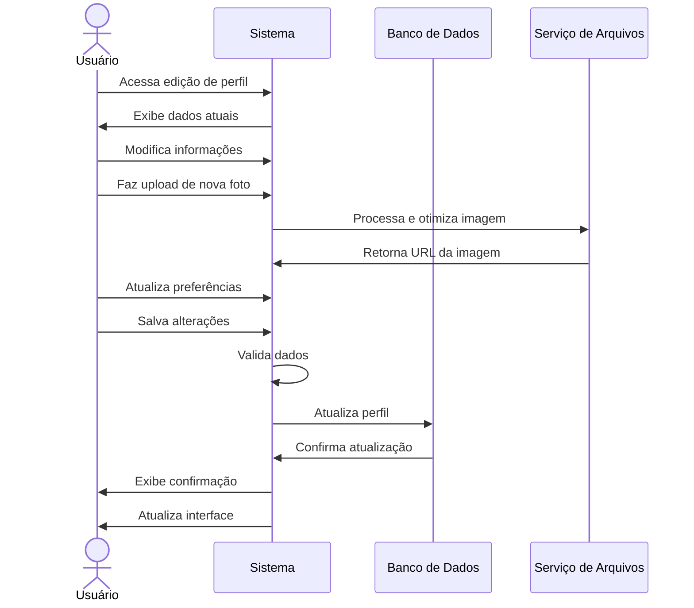

# RF006 👤 Edição de perfil com foto, informações pessoais e preferências

## 📝 Descrição

Esta funcionalidade permite que usuários editem suas informações pessoais, foto de perfil e preferências no sistema Metakyasshu, mantendo seus dados atualizados e personalizados.

## 👥 Atores

- 👤 Usuário autenticado

## ⚠️ Pré-condições

- O usuário deve estar autenticado no sistema
- O usuário deve ter permissão para editar seu próprio perfil

## 🔌 Endpoints

- `GET /api/profile`
- `PUT /api/profile`
- `POST /api/profile/avatar`
- `DELETE /api/profile/avatar`
- `PUT /api/profile/preferences`

## 📋 Dados do Perfil

| Campo           | Tipo     | Obrigatório | Descrição                    | Restrições                    |
|-----------------|----------|-------------|------------------------------|-------------------------------|
| `name`          | `string` | ✅ Sim       | Nome completo                | Máximo 100 caracteres         |
| `nickname`      | `string` | ❌ Não       | Apelido                      | Máximo 50 caracteres          |
| `email`         | `string` | ✅ Sim       | Email principal              | Formato válido                |
| `phone`         | `string` | ❌ Não       | Telefone                     | Formato brasileiro            |
| `birthDate`     | `date`   | ❌ Não       | Data de nascimento           | Data válida                   |
| `gender`        | `string` | ❌ Não       | Gênero                       | male, female, other, prefer_not_to_say |
| `avatar`        | `file`   | ❌ Não       | Foto de perfil               | JPG, PNG, máximo 5MB          |
| `bio`           | `text`   | ❌ Não       | Biografia                    | Máximo 500 caracteres         |
| `location`      | `string` | ❌ Não       | Localização                  | Máximo 100 caracteres         |
| `timezone`      | `string` | ❌ Não       | Fuso horário                 | Código de timezone válido     |
| `language`      | `string` | ✅ Sim       | Idioma preferido             | pt-BR, en-US, es-ES           |
| `currency`      | `string` | ✅ Sim       | Moeda padrão                 | BRL, USD, EUR                 |
| `notifications` | `object` | ❌ Não       | Preferências de notificação  | Objeto com configurações      |
| `theme`         | `string` | ❌ Não       | Tema da interface            | light, dark, auto             |

## 🔄 Fluxo Principal



1. O usuário acessa a seção de edição de perfil.
2. O sistema exibe os dados atuais do perfil do usuário.
3. O usuário visualiza todas as informações editáveis.
4. O usuário modifica as informações pessoais (nome, email, telefone, etc.).
5. O usuário pode fazer upload de uma nova foto de perfil.
6. O sistema processa e otimiza a imagem enviada.
7. O usuário atualiza as preferências de idioma, moeda e tema.
8. O usuário configura preferências de notificação.
9. O usuário salva as alterações do perfil.
10. O sistema valida todos os dados informados.
11. O sistema atualiza o perfil no banco de dados.
12. O sistema atualiza a interface com as novas informações.
13. O sistema exibe mensagem de confirmação.

## 🔀 Fluxos Alternativos

### ⚠️ FA01 - Alteração de email

1. O usuário altera o email principal.
2. O sistema solicita confirmação da alteração.
3. O sistema envia email de verificação para o novo endereço.
4. O usuário confirma o novo email através do link enviado.
5. O sistema atualiza o email e mantém o antigo como backup.

### ⚠️ FA02 - Remoção de foto de perfil

1. O usuário clica em "Remover Foto".
2. O sistema solicita confirmação da remoção.
3. O usuário confirma a remoção da foto.
4. O sistema remove a foto do servidor.
5. O sistema define uma foto padrão ou inicial do usuário.

### ⚠️ FA03 - Configuração de preferências avançadas

1. O usuário acessa configurações avançadas.
2. O sistema exibe opções detalhadas de personalização.
3. O usuário configura notificações específicas.
4. O usuário define preferências de privacidade.
5. O sistema aplica as configurações avançadas.

## 🚫 Fluxos de Exceção

### ⚠️ FE01 - Email já cadastrado

1. Se o novo email já estiver cadastrado por outro usuário, o sistema exibe erro.
2. O sistema informa que o email já está em uso.
3. O usuário deve escolher outro email ou manter o atual.

### ⚠️ FE02 - Arquivo de imagem inválido

1. Se o arquivo de imagem for inválido ou muito grande, o sistema exibe erro.
2. O sistema informa os formatos e tamanhos aceitos.
3. O usuário deve escolher uma imagem válida.

### ⚠️ FE03 - Dados obrigatórios não preenchidos

1. Se dados obrigatórios não forem preenchidos, o sistema exibe erro.
2. O sistema destaca os campos que precisam ser preenchidos.
3. O usuário deve completar os dados obrigatórios.

### ⚠️ FE04 - Erro no processamento da imagem

1. Se houver erro no processamento da imagem, o sistema exibe aviso.
2. O sistema mantém a foto atual.
3. O usuário pode tentar novamente ou continuar sem alterar a foto.

## 🧪 Exemplos de Uso

### Obter Dados do Perfil

```http
GET /api/profile HTTP/1.1
Host: api.metakyasshu.com
Authorization: Bearer {token}
```

### Resposta do Perfil

```json
{
  "success": true,
  "data": {
    "id": "user123",
    "name": "João Silva",
    "nickname": "João",
    "email": "joao@email.com",
    "phone": "+55 11 99999-9999",
    "birthDate": "1990-05-15",
    "gender": "male",
    "avatar": "https://cdn.metakyasshu.com/avatars/user123.jpg",
    "bio": "Apaixonado por finanças pessoais",
    "location": "São Paulo, SP",
    "timezone": "America/Sao_Paulo",
    "language": "pt-BR",
    "currency": "BRL",
    "notifications": {
      "email": true,
      "push": true,
      "sms": false
    },
    "theme": "light",
    "createdAt": "2024-01-15T10:30:00Z",
    "updatedAt": "2024-12-20T12:30:00Z"
  }
}
```

### Atualizar Perfil

```http
PUT /api/profile HTTP/1.1
Host: api.metakyasshu.com
Authorization: Bearer {token}
Content-Type: application/json

{
  "name": "João Silva Santos",
  "nickname": "João",
  "phone": "+55 11 98888-8888",
  "bio": "Especialista em finanças pessoais e investimentos",
  "location": "São Paulo, SP",
  "language": "pt-BR",
  "currency": "BRL",
  "theme": "dark",
  "notifications": {
    "email": true,
    "push": true,
    "sms": true
  }
}
```

### Upload de Avatar

```http
POST /api/profile/avatar HTTP/1.1
Host: api.metakyasshu.com
Authorization: Bearer {token}
Content-Type: multipart/form-data

[arquivo de imagem]
```

### Resposta de Atualização

```json
{
  "success": true,
  "message": "Perfil atualizado com sucesso",
  "data": {
    "updatedAt": "2024-12-20T12:30:00Z",
    "changes": {
      "name": "João Silva -> João Silva Santos",
      "phone": "+55 11 99999-9999 -> +55 11 98888-8888",
      "theme": "light -> dark"
    },
    "avatar": {
      "url": "https://cdn.metakyasshu.com/avatars/user123_new.jpg",
      "size": "245KB",
      "dimensions": "400x400"
    }
  }
}
```

### Atualizar Preferências

```http
PUT /api/profile/preferences HTTP/1.1
Host: api.metakyasshu.com
Authorization: Bearer {token}
Content-Type: application/json

{
  "language": "pt-BR",
  "currency": "BRL",
  "timezone": "America/Sao_Paulo",
  "theme": "auto",
  "notifications": {
    "email": true,
    "push": false,
    "sms": false,
    "frequency": "daily"
  }
}
```

---

> ---------------------------------------------------------------------------
> #### 💰 METAKYASSHU 💰
> ***Transformando finanças em conquistas compartilhadas***
> --------------------------------------------------------------------------- 