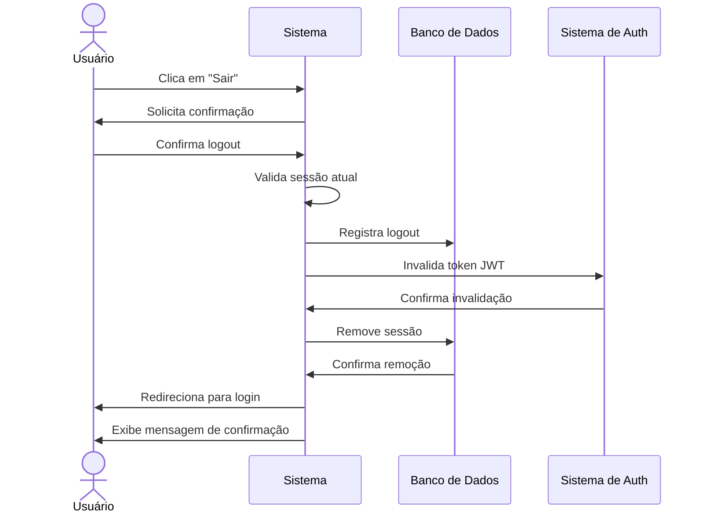

# RF007 🚪 Logout seguro com invalidação de sessões

## 📝 Descrição

Esta funcionalidade permite que usuários façam logout seguro do sistema Metakyasshu, invalidando todas as sessões ativas e garantindo a segurança dos dados.

## 👥 Atores

- 👤 Usuário autenticado
- 🔐 Sistema de autenticação

## ⚠️ Pré-condições

- O usuário deve estar autenticado no sistema
- Deve existir uma sessão ativa válida

## 🔌 Endpoints

- `POST /api/auth/logout`
- `POST /api/auth/logout/all`
- `GET /api/auth/sessions`

## 📋 Dados de Logout

| Campo           | Tipo     | Obrigatório | Descrição                    | Restrições                    |
|-----------------|----------|-------------|------------------------------|-------------------------------|
| `sessionId`     | `string` | ❌ Não       | ID da sessão específica      | UUID válido                   |
| `logoutAll`     | `boolean`| ❌ Não       | Logout de todas as sessões   | Padrão: false                 |
| `reason`        | `string` | ❌ Não       | Motivo do logout             | Máximo 100 caracteres         |
| `deviceInfo`    | `object` | ❌ Não       | Informações do dispositivo   | Objeto com dados do device    |

## 🔄 Fluxo Principal



1. O usuário clica no botão "Sair" ou "Logout" no sistema.
2. O sistema exibe uma confirmação de logout.
3. O usuário confirma que deseja sair do sistema.
4. O sistema valida a sessão atual do usuário.
5. O sistema registra o logout no banco de dados.
6. O sistema invalida o token JWT da sessão atual.
7. O sistema remove a sessão do banco de dados.
8. O sistema limpa os dados da sessão local.
9. O sistema redireciona o usuário para a página de login.
10. O sistema exibe mensagem de logout realizado com sucesso.

## 🔀 Fluxos Alternativos

### ⚠️ FA01 - Logout de todas as sessões

1. O usuário seleciona "Sair de todos os dispositivos".
2. O sistema solicita confirmação adicional.
3. O usuário confirma o logout de todas as sessões.
4. O sistema invalida todos os tokens JWT do usuário.
5. O sistema remove todas as sessões do banco de dados.
6. O sistema notifica outros dispositivos sobre o logout.

### ⚠️ FA02 - Logout por inatividade

1. O sistema detecta inatividade do usuário.
2. O sistema exibe aviso de sessão expirando.
3. O usuário não responde ao aviso.
4. O sistema executa logout automático.
5. O sistema registra logout por inatividade.

### ⚠️ FA03 - Logout forçado por segurança

1. O sistema detecta atividade suspeita.
2. O sistema força logout por segurança.
3. O sistema invalida todas as sessões.
4. O sistema notifica o usuário por email.
5. O usuário deve fazer login novamente.

## 🚫 Fluxos de Exceção

### ⚠️ FE01 - Sessão já inválida

1. Se a sessão já estiver inválida, o sistema exibe mensagem de erro.
2. O sistema redireciona para login automaticamente.
3. O usuário deve fazer login novamente.

### ⚠️ FE02 - Erro na invalidação do token

1. Se houver erro na invalidação do token, o sistema registra o erro.
2. O sistema tenta invalidar o token novamente.
3. O sistema força logout mesmo com erro.

### ⚠️ FE03 - Erro no banco de dados

1. Se houver erro ao remover a sessão do banco, o sistema registra o erro.
2. O sistema continua com o logout local.
3. O sistema agenda limpeza posterior das sessões órfãs.

### ⚠️ FE04 - Logout em dispositivo compartilhado

1. Se detectar dispositivo compartilhado, o sistema exibe aviso.
2. O sistema sugere logout de todas as sessões.
3. O usuário pode escolher logout parcial ou completo.

## 🧪 Exemplos de Uso

### Logout da Sessão Atual

```http
POST /api/auth/logout HTTP/1.1
Host: api.metakyasshu.com
Authorization: Bearer {token}
Content-Type: application/json

{
  "reason": "user_request",
  "deviceInfo": {
    "device": "desktop",
    "browser": "Chrome",
    "ip": "192.168.1.100"
  }
}
```

### Logout de Todas as Sessões

```http
POST /api/auth/logout/all HTTP/1.1
Host: api.metakyasshu.com
Authorization: Bearer {token}
Content-Type: application/json

{
  "reason": "security_concern",
  "deviceInfo": {
    "device": "mobile",
    "browser": "Safari",
    "ip": "192.168.1.101"
  }
}
```

### Resposta de Sucesso

```json
{
  "success": true,
  "message": "Logout realizado com sucesso",
  "data": {
    "logoutTime": "2024-12-20T12:30:00Z",
    "sessionsInvalidated": 1,
    "reason": "user_request",
    "redirectTo": "/login"
  }
}
```

### Listar Sessões Ativas

```http
GET /api/auth/sessions HTTP/1.1
Host: api.metakyasshu.com
Authorization: Bearer {token}
```

```json
{
  "sessions": [
    {
      "id": "session123",
      "device": "desktop",
      "browser": "Chrome",
      "ip": "192.168.1.100",
      "lastActivity": "2024-12-20T12:25:00Z",
      "isCurrent": true
    },
    {
      "id": "session456",
      "device": "mobile",
      "browser": "Safari",
      "ip": "192.168.1.101",
      "lastActivity": "2024-12-20T11:45:00Z",
      "isCurrent": false
    }
  ]
}
```

### Logout de Sessão Específica

```http
POST /api/auth/logout HTTP/1.1
Host: api.metakyasshu.com
Authorization: Bearer {token}
Content-Type: application/json

{
  "sessionId": "session456",
  "reason": "device_lost"
}
```

---

> ---------------------------------------------------------------------------
> #### 💰 METAKYASSHU 💰
> ***Transformando finanças em conquistas compartilhadas***
> --------------------------------------------------------------------------- 