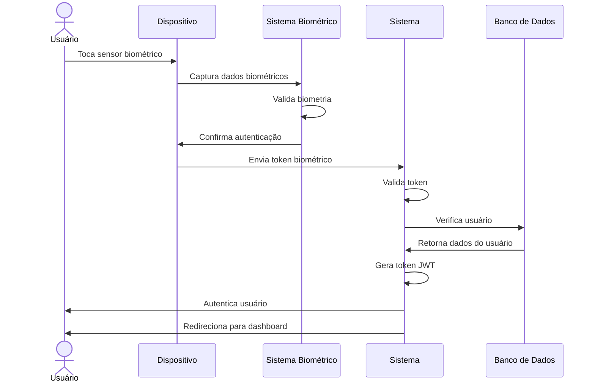

# RF008 📱 Autenticação biométrica (impressão digital, face ID)

## 📝 Descrição

Esta funcionalidade permite que usuários utilizem autenticação biométrica (impressão digital, Face ID, Touch ID) para acessar o sistema Metakyasshu de forma segura e conveniente.

## 👥 Atores

- 👤 Usuário autenticado
- 📱 Dispositivo móvel
- 🔐 Sistema biométrico

## ⚠️ Pré-condições

- O usuário deve estar cadastrado no sistema
- O dispositivo deve suportar autenticação biométrica
- O usuário deve ter configurado biometria no dispositivo

## 🔌 Endpoints

- `POST /api/auth/biometric/enable`
- `POST /api/auth/biometric/disable`
- `POST /api/auth/biometric/verify`
- `GET /api/auth/biometric/status`

## 📋 Dados de Autenticação Biométrica

| Campo           | Tipo     | Obrigatório | Descrição                    | Restrições                    |
|-----------------|----------|-------------|------------------------------|-------------------------------|
| `biometricType` | `string` | ✅ Sim       | Tipo de biometria            | fingerprint, face, iris       |
| `deviceId`      | `string` | ✅ Sim       | ID único do dispositivo      | UUID válido                   |
| `biometricData` | `string` | ✅ Sim       | Hash dos dados biométricos   | Hash seguro                   |
| `isEnabled`     | `boolean`| ✅ Sim       | Status de ativação           | true/false                    |
| `lastUsed`      | `date`   | ❌ Não       | Último uso                   | Data válida                   |
| `securityLevel` | `string` | ❌ Não       | Nível de segurança           | low, medium, high             |

## 🔄 Fluxo Principal



1. O usuário toca o sensor de impressão digital ou posiciona o rosto para Face ID.
2. O dispositivo captura os dados biométricos do usuário.
3. O sistema biométrico do dispositivo valida os dados capturados.
4. O dispositivo confirma a autenticação biométrica.
5. O dispositivo envia um token biométrico seguro para o sistema.
6. O sistema valida o token biométrico recebido.
7. O sistema verifica se o usuário está cadastrado e ativo.
8. O sistema gera um token JWT de autenticação.
9. O sistema autentica o usuário no sistema.
10. O sistema redireciona o usuário para o dashboard principal.

## 🔀 Fluxos Alternativos

### ⚠️ FA01 - Primeira configuração de biometria

1. O usuário acessa configurações de segurança.
2. O usuário seleciona "Ativar Autenticação Biométrica".
3. O sistema verifica se o dispositivo suporta biometria.
4. O sistema solicita configuração no dispositivo.
5. O usuário configura biometria no dispositivo.
6. O sistema salva a configuração biométrica.
7. O sistema ativa a autenticação biométrica.

### ⚠️ FA02 - Múltiplos tipos de biometria

1. O usuário pode configurar impressão digital e Face ID.
2. O sistema permite escolher qual método usar.
3. O usuário pode alternar entre os métodos.
4. O sistema mantém ambos os métodos ativos.

### ⚠️ FA03 - Autenticação biométrica para ações sensíveis

1. O usuário tenta realizar ação sensível (transferência, configurações).
2. O sistema solicita autenticação biométrica adicional.
3. O usuário confirma com biometria.
4. O sistema permite a ação sensível.

## 🚫 Fluxos de Exceção

### ⚠️ FE01 - Dispositivo não suporta biometria

1. Se o dispositivo não suportar biometria, o sistema exibe mensagem de erro.
2. O sistema sugere usar autenticação tradicional.
3. O usuário deve usar email/senha para login.

### ⚠️ FE02 - Biometria não configurada

1. Se a biometria não estiver configurada no dispositivo, o sistema exibe aviso.
2. O sistema solicita configuração da biometria.
3. O usuário deve configurar biometria no dispositivo primeiro.

### ⚠️ FE03 - Falha na autenticação biométrica

1. Se a autenticação biométrica falhar, o sistema exibe mensagem de erro.
2. O sistema permite nova tentativa.
3. Após múltiplas falhas, o sistema bloqueia temporariamente.

### ⚠️ FE04 - Dispositivo não reconhecido

1. Se o dispositivo não for reconhecido, o sistema exibe aviso de segurança.
2. O sistema solicita autenticação adicional.
3. O usuário deve confirmar o dispositivo ou usar login tradicional.

## 🧪 Exemplos de Uso

### Ativar Autenticação Biométrica

```http
POST /api/auth/biometric/enable HTTP/1.1
Host: api.metakyasshu.com
Authorization: Bearer {token}
Content-Type: application/json

{
  "biometricType": "fingerprint",
  "deviceId": "device123",
  "securityLevel": "high"
}
```

### Resposta de Ativação

```json
{
  "success": true,
  "message": "Autenticação biométrica ativada com sucesso",
  "data": {
    "biometricType": "fingerprint",
    "deviceId": "device123",
    "isEnabled": true,
    "activatedAt": "2024-12-20T12:30:00Z",
    "securityLevel": "high"
  }
}
```

### Verificar Status da Biometria

```http
GET /api/auth/biometric/status HTTP/1.1
Host: api.metakyasshu.com
Authorization: Bearer {token}
```

```json
{
  "biometricStatus": {
    "isEnabled": true,
    "biometricType": "fingerprint",
    "deviceId": "device123",
    "lastUsed": "2024-12-20T12:25:00Z",
    "securityLevel": "high",
    "deviceSupported": true
  }
}
```

### Autenticação Biométrica

```http
POST /api/auth/biometric/verify HTTP/1.1
Host: api.metakyasshu.com
Content-Type: application/json

{
  "biometricToken": "biometric_token_123",
  "deviceId": "device123",
  "biometricType": "fingerprint"
}
```

### Resposta de Autenticação

```json
{
  "success": true,
  "message": "Autenticação biométrica realizada com sucesso",
  "data": {
    "token": "eyJhbGciOiJIUzI1NiIsInR5cCI6IkpXVCJ9...",
    "user": {
      "id": "user123",
      "name": "João Silva",
      "email": "joao@email.com"
    },
    "expiresAt": "2024-12-21T12:30:00Z",
    "authMethod": "biometric"
  }
}
```

### Desativar Biometria

```http
POST /api/auth/biometric/disable HTTP/1.1
Host: api.metakyasshu.com
Authorization: Bearer {token}
Content-Type: application/json

{
  "deviceId": "device123",
  "reason": "security_concern"
}
```

---

> ---------------------------------------------------------------------------
> #### 💰 METAKYASSHU 💰
> ***Transformando finanças em conquistas compartilhadas***
> --------------------------------------------------------------------------- 