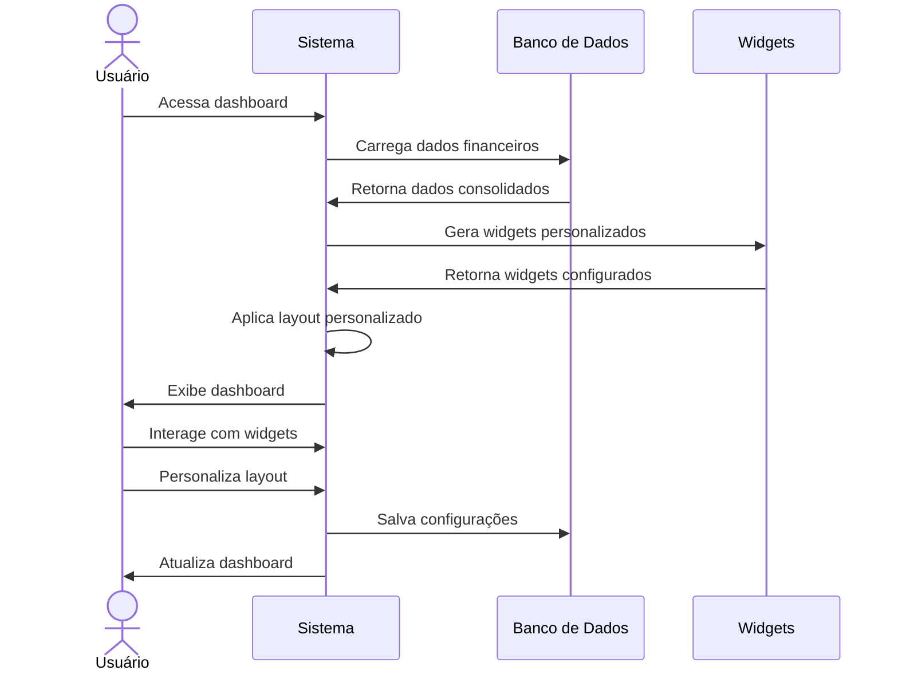

# RF009 📈 Dashboard personalizável com visão consolidada das finanças

## 📝 Descrição

Esta funcionalidade permite que usuários visualizem e personalizem um dashboard consolidado no sistema Metakyasshu, exibindo informações financeiras relevantes de forma organizada e customizável.

## 👥 Atores

- 👤 Usuário autenticado

## ⚠️ Pré-condições

- O usuário deve estar autenticado no sistema
- O usuário deve ter dados financeiros registrados

## 🔌 Endpoints

- `GET /api/dashboard`
- `PUT /api/dashboard/layout`
- `GET /api/dashboard/widgets`
- `POST /api/dashboard/widgets`
- `DELETE /api/dashboard/widgets/{id}`

## 📋 Dados do Dashboard

| Campo           | Tipo     | Obrigatório | Descrição                    | Restrições                    |
|-----------------|----------|-------------|------------------------------|-------------------------------|
| `layout`        | `object` | ✅ Sim       | Layout dos widgets           | Objeto com posições           |
| `widgets`       | `array`  | ✅ Sim       | Lista de widgets ativos      | Array de widgets              |
| `period`        | `string` | ✅ Sim       | Período de análise           | current_month, last_month, custom |
| `theme`         | `string` | ❌ Não       | Tema do dashboard            | light, dark, auto             |
| `refreshRate`   | `integer`| ❌ Não       | Taxa de atualização (minutos) | Entre 1 e 60                 |
| `defaultView`   | `string` | ❌ Não       | Visualização padrão          | overview, detailed, compact   |

## 🔄 Fluxo Principal



1. O usuário acessa o dashboard principal do sistema.
2. O sistema carrega os dados financeiros consolidados do usuário.
3. O sistema gera os widgets baseados nas configurações do usuário.
4. O sistema aplica o layout personalizado salvo.
5. O sistema exibe o dashboard com informações atualizadas.
6. O usuário visualiza saldo atual, receitas, despesas e metas.
7. O usuário pode interagir com os widgets (gráficos, listas, etc.).
8. O usuário pode personalizar o layout arrastando widgets.
9. O usuário pode adicionar ou remover widgets.
10. O sistema salva as configurações de personalização.
11. O sistema atualiza o dashboard em tempo real.
12. O sistema exibe alertas e notificações relevantes.

## 🔀 Fluxos Alternativos

### ⚠️ FA01 - Dashboard por período personalizado

1. O usuário seleciona período personalizado.
2. O sistema solicita data inicial e final.
3. O sistema recalcula dados para o período.
4. O sistema atualiza todos os widgets.
5. O sistema salva preferência de período.

### ⚠️ FA02 - Dashboard compartilhado por grupo

1. O usuário acessa dashboard de grupo.
2. O sistema carrega dados consolidados do grupo.
3. O sistema exibe widgets específicos do grupo.
4. O usuário visualiza contribuições de membros.
5. O sistema atualiza dados em tempo real.

### ⚠️ FA03 - Dashboard com filtros avançados

1. O usuário ativa filtros avançados.
2. O sistema exibe opções de filtro por categoria, grupo, status.
3. O usuário aplica filtros específicos.
4. O sistema recalcula dados filtrados.
5. O sistema atualiza widgets com dados filtrados.

## 🚫 Fluxos de Exceção

### ⚠️ FE01 - Dados insuficientes

1. Se não houver dados suficientes, o sistema exibe widgets vazios.
2. O sistema sugere registrar primeiras transações.
3. O sistema exibe tutoriais de uso.

### ⚠️ FE02 - Widget não disponível

1. Se um widget não estiver disponível, o sistema exibe aviso.
2. O sistema sugere widgets alternativos.
3. O usuário pode remover o widget indisponível.

### ⚠️ FE03 - Erro na atualização

1. Se houver erro na atualização, o sistema exibe dados em cache.
2. O sistema tenta atualizar novamente em background.
3. O sistema notifica quando dados estiverem atualizados.

### ⚠️ FE04 - Layout inválido

1. Se o layout for inválido, o sistema restaura layout padrão.
2. O sistema exibe aviso sobre o problema.
3. O usuário pode reconfigurar o layout.

## 🧪 Exemplos de Uso

### Obter Dashboard

```http
GET /api/dashboard HTTP/1.1
Host: api.metakyasshu.com
Authorization: Bearer {token}
```

### Resposta do Dashboard

```json
{
  "success": true,
  "data": {
    "layout": {
      "columns": 3,
      "widgets": [
        {
          "id": "balance_card",
          "position": {"x": 0, "y": 0, "w": 1, "h": 1},
          "type": "balance"
        },
        {
          "id": "expenses_chart",
          "position": {"x": 1, "y": 0, "w": 2, "h": 2},
          "type": "chart"
        }
      ]
    },
    "widgets": {
      "balance_card": {
        "type": "balance",
        "data": {
          "currentBalance": 5000.00,
          "monthlyIncome": 8000.00,
          "monthlyExpenses": 3000.00,
          "savings": 2000.00
        }
      },
      "expenses_chart": {
        "type": "chart",
        "data": {
          "categories": ["Alimentação", "Transporte", "Moradia"],
          "values": [800, 400, 1200]
        }
      }
    },
    "period": "current_month",
    "lastUpdated": "2024-12-20T12:30:00Z"
  }
}
```

### Atualizar Layout

```http
PUT /api/dashboard/layout HTTP/1.1
Host: api.metakyasshu.com
Authorization: Bearer {token}
Content-Type: application/json

{
  "layout": {
    "columns": 4,
    "widgets": [
      {
        "id": "balance_card",
        "position": {"x": 0, "y": 0, "w": 1, "h": 1}
      },
      {
        "id": "expenses_chart",
        "position": {"x": 1, "y": 0, "w": 3, "h": 2}
      }
    ]
  }
}
```

### Adicionar Widget

```http
POST /api/dashboard/widgets HTTP/1.1
Host: api.metakyasshu.com
Authorization: Bearer {token}
Content-Type: application/json

{
  "type": "goals_progress",
  "position": {"x": 0, "y": 1, "w": 2, "h": 1},
  "config": {
    "showCompleted": true,
    "limit": 5
  }
}
```

### Resposta de Atualização

```json
{
  "success": true,
  "message": "Dashboard atualizado com sucesso",
  "data": {
    "updatedAt": "2024-12-20T12:30:00Z",
    "widgetsCount": 3,
    "layoutSaved": true
  }
}
```

---

> ---------------------------------------------------------------------------
> #### 💰 METAKYASSHU 💰
> ***Transformando finanças em conquistas compartilhadas***
> --------------------------------------------------------------------------- 