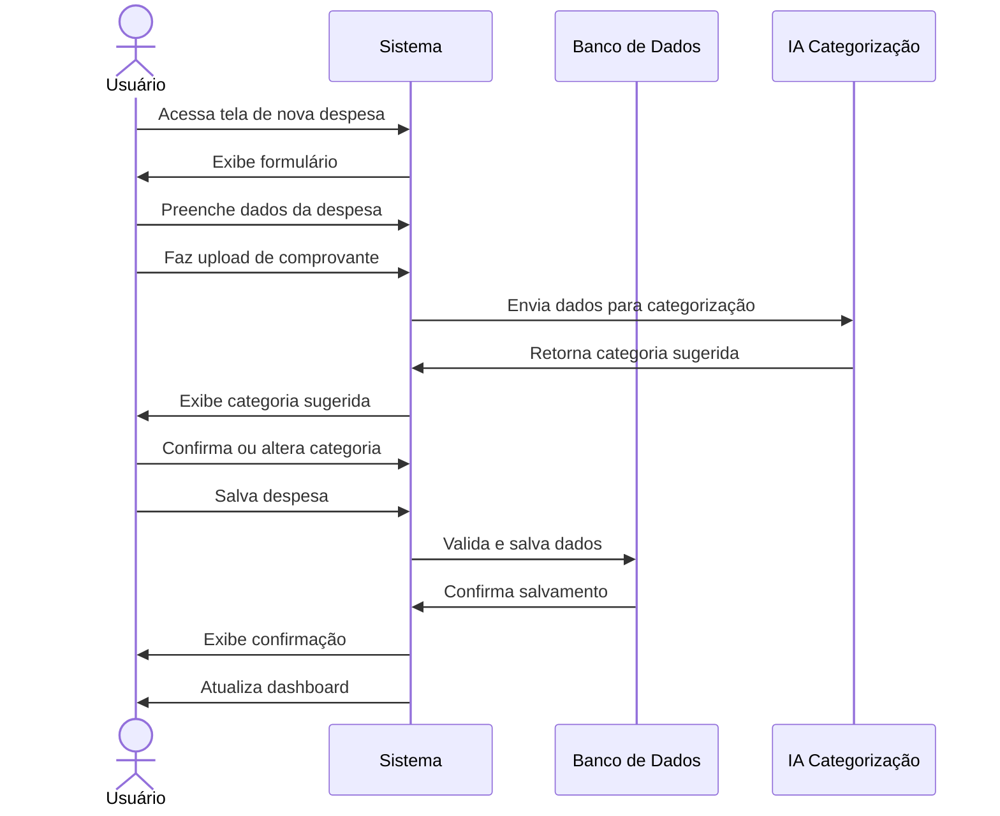

# RF025 📝 Registro detalhado de despesas com data, valor, descrição e notas

## 📝 Descrição

Esta funcionalidade permite que usuários registrem despesas detalhadas no sistema Metakyasshu com informações completas como data, valor, descrição e notas adicionais.

## 👥 Atores

- 👤 Usuário autenticado
- 👥 Membro de grupo (se aplicável)

## ⚠️ Pré-condições

- O usuário deve estar autenticado no sistema
- O usuário deve ter permissão para registrar despesas

## 🔌 Endpoints

- `POST /api/expenses`
- `GET /api/expenses`
- `PUT /api/expenses/{id}`
- `DELETE /api/expenses/{id}`

## 📋 Dados da Despesa

| Campo           | Tipo      | Obrigatório | Descrição                    | Restrições                    |
|-----------------|-----------|-------------|------------------------------|-------------------------------|
| `description`   | `string`  | ✅ Sim       | Descrição da despesa         | Máximo 255 caracteres         |
| `amount`        | `decimal` | ✅ Sim       | Valor da despesa             | Maior que zero                |
| `date`          | `date`    | ✅ Sim       | Data da despesa              | Data válida                   |
| `category`      | `string`  | ✅ Sim       | Categoria da despesa         | Categoria válida              |
| `paymentMethod` | `string`  | ✅ Sim       | Forma de pagamento           | Método válido                 |
| `notes`         | `text`    | ❌ Não       | Notas adicionais             | Máximo 1000 caracteres        |
| `groupId`       | `string`  | ❌ Não       | ID do grupo                  | Grupo válido                  |
| `goalId`        | `string`  | ❌ Não       | ID da meta relacionada       | Meta válida                   |
| `attachments`   | `files`   | ❌ Não       | Comprovantes e anexos        | Máximo 5 arquivos             |
| `status`        | `string`  | ✅ Sim       | Status do pagamento          | Paga, pendente, vencida       |

## 🔄 Fluxo Principal



1. O usuário acessa a tela de registro de nova despesa.
2. O sistema exibe o formulário de despesa com todos os campos necessários.
3. O usuário preenche os dados obrigatórios (descrição, valor, data, categoria, forma de pagamento).
4. O usuário pode adicionar notas opcionais e anexar comprovantes.
5. O sistema utiliza IA para sugerir categoria baseada na descrição.
6. O usuário confirma a categoria sugerida ou seleciona uma diferente.
7. O usuário pode relacionar a despesa a um grupo ou meta financeira.
8. O usuário salva a despesa.
9. O sistema valida todos os dados informados.
10. O sistema salva a despesa no banco de dados.
11. O sistema atualiza o dashboard com a nova despesa.
12. O sistema exibe mensagem de confirmação.

## 🔀 Fluxos Alternativos

### ⚠️ FA01 - Despesa compartilhada em grupo

1. O usuário seleciona um grupo ao registrar a despesa.
2. O sistema solicita informações sobre divisão da despesa.
3. O usuário define como a despesa será dividida entre membros.
4. O sistema cria automaticamente empréstimos para outros membros.
5. O sistema notifica os membros do grupo sobre a nova despesa.

### ⚠️ FA02 - Despesa relacionada a meta

1. O usuário seleciona uma meta financeira ao registrar a despesa.
2. O sistema atualiza o progresso da meta automaticamente.
3. O sistema verifica se a despesa impacta o alcance da meta.
4. O sistema pode sugerir ajustes na meta se necessário.

### ⚠️ FA03 - Despesa recorrente

1. O usuário marca a despesa como recorrente.
2. O sistema solicita frequência (mensal, semanal, etc.).
3. O sistema cria automaticamente as próximas ocorrências.
4. O usuário pode definir data de fim da recorrência.

## 🚫 Fluxos de Exceção

### ⚠️ FE01 - Dados obrigatórios não preenchidos

1. No passo 9 do fluxo principal, se dados obrigatórios não forem preenchidos, o sistema exibe mensagem de erro.
2. O sistema destaca os campos que precisam ser preenchidos.
3. O usuário corrige os dados e tenta salvar novamente.

### ⚠️ FE02 - Valor inválido

1. Se o valor informado for zero ou negativo, o sistema exibe mensagem de erro.
2. O sistema solicita correção do valor.

### ⚠️ FE03 - Data futura

1. Se a data informada for futura, o sistema exibe aviso.
2. O usuário pode confirmar ou alterar a data.

### ⚠️ FE04 - Erro no upload de arquivo

1. Se houver erro no upload de comprovante, o sistema exibe mensagem de erro.
2. O sistema permite nova tentativa de upload ou continua sem o arquivo.

## 🧪 Exemplos de Uso

### Requisição de Nova Despesa

```http
POST /api/expenses HTTP/1.1
Host: api.metakyasshu.com
Authorization: Bearer {token}
Content-Type: application/json

{
  "description": "Almoço no restaurante",
  "amount": 45.50,
  "date": "2024-12-20",
  "category": "Alimentação",
  "paymentMethod": "PIX",
  "notes": "Almoço com cliente",
  "groupId": "group123",
  "goalId": "goal456",
  "status": "paid"
}
```

### Resposta de Sucesso

```json
{
  "success": true,
  "message": "Despesa registrada com sucesso",
  "data": {
    "id": "expense789",
    "description": "Almoço no restaurante",
    "amount": 45.50,
    "date": "2024-12-20",
    "category": "Alimentação",
    "paymentMethod": "PIX",
    "status": "paid",
    "createdAt": "2024-12-20T12:30:00Z",
    "suggestedCategory": "Alimentação",
    "categoryConfidence": 0.95
  }
}
```

### Categorização Automática

```json
{
  "suggestedCategory": "Alimentação",
  "confidence": 0.95,
  "alternatives": [
    {"category": "Restaurante", "confidence": 0.85},
    {"category": "Delivery", "confidence": 0.10}
  ]
}
```

---

> ---------------------------------------------------------------------------
> #### 💰 METAKYASSHU 💰
> ***Transformando finanças em conquistas compartilhadas***
> --------------------------------------------------------------------------- 