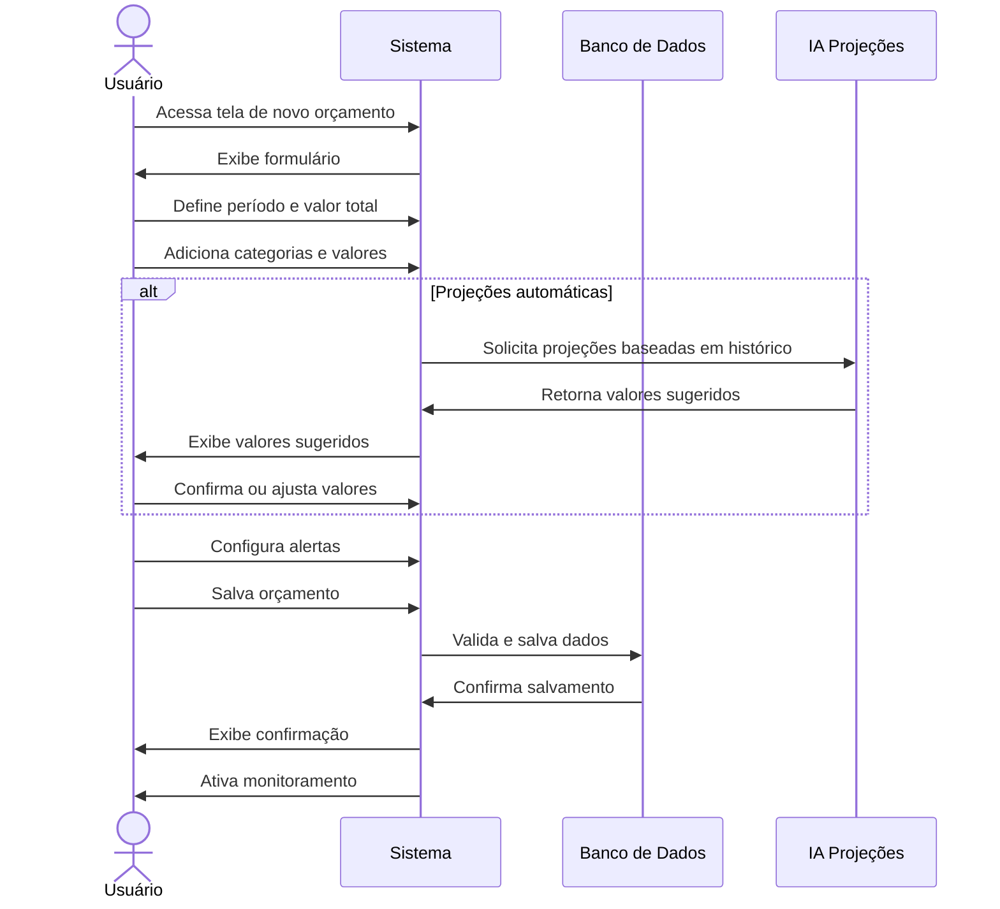

# RF105 📊 Criação de orçamentos mensais e anuais

## 📝 Descrição

Esta funcionalidade permite que usuários criem orçamentos mensais e anuais no sistema Metakyasshu para planejamento e controle financeiro.

## 👥 Atores

- 👤 Usuário autenticado
- 👥 Membro de grupo (se orçamento compartilhado)

## ⚠️ Pré-condições

- O usuário deve estar autenticado no sistema
- O usuário deve ter permissão para criar orçamentos

## 🔌 Endpoints

- `POST /api/budgets`
- `GET /api/budgets`
- `PUT /api/budgets/{id}`
- `DELETE /api/budgets/{id}`

## 📋 Dados do Orçamento

| Campo           | Tipo      | Obrigatório | Descrição                    | Restrições                    |
|-----------------|-----------|-------------|------------------------------|-------------------------------|
| `name`          | `string`  | ✅ Sim       | Nome do orçamento            | Máximo 100 caracteres         |
| `description`   | `text`    | ❌ Não       | Descrição do orçamento       | Máximo 500 caracteres         |
| `type`          | `string`  | ✅ Sim       | Tipo de período              | Mensal, anual, personalizado  |
| `startDate`     | `date`    | ✅ Sim       | Data de início               | Data válida                   |
| `endDate`       | `date`    | ✅ Sim       | Data de fim                  | Data posterior ao início       |
| `totalAmount`   | `decimal` | ✅ Sim       | Valor total do orçamento     | Maior que zero                |
| `currency`      | `string`  | ✅ Sim       | Moeda padrão                 | Código de moeda válido         |
| `categories`    | `array`   | ✅ Sim       | Categorias e valores         | Pelo menos uma categoria       |
| `groupId`       | `string`  | ❌ Não       | ID do grupo                  | Grupo válido                  |
| `alerts`        | `object`  | ❌ Não       | Configurações de alerta      | Percentual de alerta           |
| `projections`   | `boolean` | ❌ Não       | Usar projeções automáticas   | Baseado em histórico           |

## 🔄 Fluxo Principal



1. O usuário acessa a tela de criação de novo orçamento.
2. O sistema exibe o formulário de orçamento com campos para período e valor total.
3. O usuário define o tipo de período (mensal, anual, personalizado).
4. O usuário informa as datas de início e fim do orçamento.
5. O usuário define o valor total do orçamento.
6. O usuário adiciona categorias e define valores para cada uma.
7. O sistema pode sugerir valores baseados em histórico (projeções automáticas).
8. O usuário confirma ou ajusta os valores sugeridos.
9. O usuário configura alertas de limite (percentual de alerta).
10. O usuário pode definir o orçamento como compartilhado com grupo.
11. O usuário salva o orçamento.
12. O sistema valida todos os dados informados.
13. O sistema salva o orçamento no banco de dados.
14. O sistema ativa o monitoramento de alertas.
15. O sistema exibe mensagem de confirmação.

## 🔀 Fluxos Alternativos

### ⚠️ FA01 - Orçamento compartilhado por grupo

1. O usuário seleciona um grupo ao criar o orçamento.
2. O sistema solicita informações sobre divisão do orçamento.
3. O usuário define como o orçamento será dividido entre membros.
4. O sistema cria orçamentos individuais para cada membro.
5. O sistema notifica os membros do grupo sobre o novo orçamento.

### ⚠️ FA02 - Orçamento baseado em template

1. O usuário seleciona um template de orçamento existente.
2. O sistema carrega as categorias e valores do template.
3. O usuário pode ajustar os valores conforme necessário.
4. O usuário salva o orçamento personalizado.

### ⚠️ FA03 - Orçamento com projeções automáticas

1. O usuário ativa projeções automáticas.
2. O sistema analisa histórico de gastos dos últimos meses.
3. O sistema sugere valores para cada categoria.
4. O usuário pode ajustar os valores sugeridos.
5. O sistema considera sazonalidade e tendências.

## 🚫 Fluxos de Exceção

### ⚠️ FE01 - Soma das categorias diferente do total

1. Se a soma dos valores das categorias for diferente do valor total, o sistema exibe mensagem de erro.
2. O sistema destaca a diferença encontrada.
3. O usuário pode ajustar os valores ou usar distribuição automática.

### ⚠️ FE02 - Período inválido

1. Se a data de fim for anterior à data de início, o sistema exibe mensagem de erro.
2. O sistema solicita correção das datas.

### ⚠️ FE03 - Categoria sem valor

1. Se alguma categoria não tiver valor definido, o sistema exibe mensagem de erro.
2. O sistema destaca as categorias que precisam de valor.

### ⚠️ FE04 - Orçamento sobreposto

1. Se já existir orçamento para o período informado, o sistema exibe aviso.
2. O usuário pode cancelar ou criar mesmo assim.

## 🧪 Exemplos de Uso

### Requisição de Novo Orçamento

```http
POST /api/budgets HTTP/1.1
Host: api.metakyasshu.com
Authorization: Bearer {token}
Content-Type: application/json

{
  "name": "Orçamento Janeiro 2024",
  "description": "Orçamento mensal para janeiro",
  "type": "monthly",
  "startDate": "2024-01-01",
  "endDate": "2024-01-31",
  "totalAmount": 5000.00,
  "currency": "BRL",
  "categories": [
    {
      "category": "Alimentação",
      "amount": 800.00,
      "percentage": 16.0
    },
    {
      "category": "Transporte",
      "amount": 400.00,
      "percentage": 8.0
    },
    {
      "category": "Moradia",
      "amount": 2000.00,
      "percentage": 40.0
    }
  ],
  "alerts": {
    "warningPercentage": 80,
    "criticalPercentage": 95
  },
  "projections": true
}
```

### Resposta de Sucesso

```json
{
  "success": true,
  "message": "Orçamento criado com sucesso",
  "data": {
    "id": "budget123",
    "name": "Orçamento Janeiro 2024",
    "type": "monthly",
    "startDate": "2024-01-01",
    "endDate": "2024-01-31",
    "totalAmount": 5000.00,
    "status": "active",
    "createdAt": "2024-12-20T12:30:00Z",
    "projections": {
      "accuracy": 0.85,
      "basedOnMonths": 6
    }
  }
}
```

### Projeções Automáticas

```json
{
  "projections": [
    {
      "category": "Alimentação",
      "suggestedAmount": 850.00,
      "confidence": 0.90,
      "basedOn": "Últimos 6 meses"
    },
    {
      "category": "Transporte",
      "suggestedAmount": 420.00,
      "confidence": 0.85,
      "basedOn": "Últimos 6 meses"
    }
  ]
}
```

---

> ---------------------------------------------------------------------------
> #### 💰 METAKYASSHU 💰
> ***Transformando finanças em conquistas compartilhadas***
> --------------------------------------------------------------------------- 