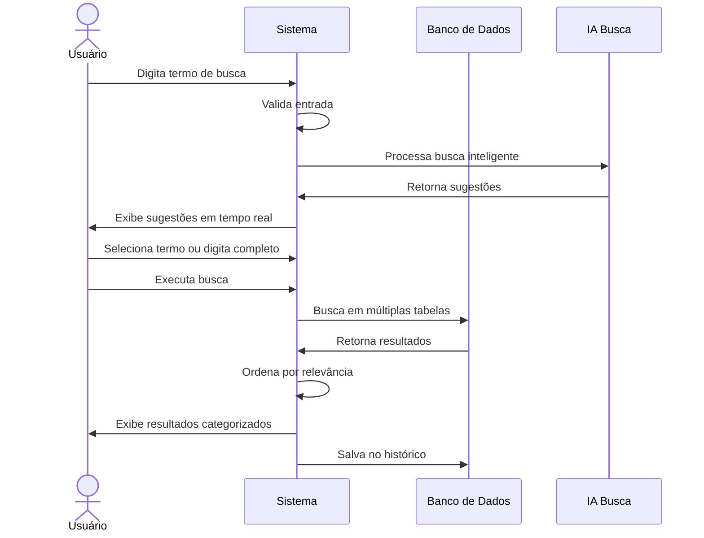

# RF117 🔍 Busca global em todo o sistema

## 📝 Descrição

Esta funcionalidade permite que usuários realizem buscas globais em todo o sistema Metakyasshu, incluindo despesas, receitas, metas, grupos, cartões e outros elementos.

## 👥 Atores

- 👤 Usuário autenticado

## ⚠️ Pré-condições

- O usuário deve estar autenticado no sistema
- O usuário deve ter permissão para acessar os dados buscados

## 🔌 Endpoints

- `GET /api/search`
- `GET /api/search/suggestions`
- `GET /api/search/history`

## 📋 Parâmetros de Busca

| Campo        | Tipo     | Obrigatório | Descrição                    | Restrições                    |
|--------------|----------|-------------|------------------------------|-------------------------------|
| `query`      | `string` | ✅ Sim       | Termo de busca               | Mínimo 2 caracteres           |
| `type`       | `string` | ❌ Não       | Tipo de resultado            | expenses, income, goals, etc. |
| `dateFrom`   | `date`   | ❌ Não       | Data inicial                 | Data válida                   |
| `dateTo`     | `date`   | ❌ Não       | Data final                   | Data válida                   |
| `category`   | `string` | ❌ Não       | Categoria específica         | Categoria válida              |
| `amountMin`  | `decimal`| ❌ Não       | Valor mínimo                 | Número positivo               |
| `amountMax`  | `decimal`| ❌ Não       | Valor máximo                 | Número positivo               |
| `groupId`    | `string` | ❌ Não       | Grupo específico             | Grupo válido                  |
| `limit`      | `integer`| ❌ Não       | Limite de resultados         | Máximo 100                    |
| `offset`     | `integer`| ❌ Não       | Paginação                    | Número positivo               |

## 🔄 Fluxo Principal



1. O usuário acessa a barra de busca global do sistema.
2. O usuário digita o termo de busca (mínimo 2 caracteres).
3. O sistema valida a entrada e processa a busca em tempo real.
4. O sistema utiliza IA para processar busca inteligente e fuzzy.
5. O sistema exibe sugestões de busca baseadas no histórico e padrões.
6. O usuário pode selecionar uma sugestão ou continuar digitando.
7. O usuário executa a busca (Enter ou botão).
8. O sistema busca em todas as tabelas relevantes (despesas, receitas, metas, etc.).
9. O sistema aplica filtros adicionais se especificados.
10. O sistema ordena os resultados por relevância e data.
11. O sistema agrupa os resultados por categoria.
12. O sistema exibe os resultados de forma organizada.
13. O sistema salva a busca no histórico do usuário.

## 🔀 Fluxos Alternativos

### ⚠️ FA01 - Busca com filtros avançados

1. O usuário clica em "Busca Avançada".
2. O sistema exibe formulário com filtros adicionais.
3. O usuário define filtros por data, valor, categoria, grupo.
4. O usuário executa a busca com filtros.
5. O sistema aplica todos os filtros na busca.
6. O sistema exibe resultados filtrados.

### ⚠️ FA02 - Busca por voz

1. O usuário clica no ícone de microfone.
2. O sistema ativa reconhecimento de voz.
3. O usuário fala o termo de busca.
4. O sistema converte fala em texto.
5. O sistema executa a busca automaticamente.

### ⚠️ FA03 - Busca em histórico

1. O usuário clica no histórico de buscas.
2. O sistema exibe buscas anteriores.
3. O usuário seleciona uma busca anterior.
4. O sistema executa a busca novamente.

## 🚫 Fluxos de Exceção

### ⚠️ FE01 - Termo muito curto

1. Se o usuário digitar menos de 2 caracteres, o sistema não executa a busca.
2. O sistema exibe mensagem solicitando mais caracteres.

### ⚠️ FE02 - Nenhum resultado encontrado

1. Se nenhum resultado for encontrado, o sistema exibe mensagem apropriada.
2. O sistema sugere termos similares ou alternativas.
3. O sistema pode sugerir verificar ortografia.

### ⚠️ FE03 - Muitos resultados

1. Se houver muitos resultados, o sistema aplica paginação.
2. O sistema exibe total de resultados encontrados.
3. O usuário pode navegar entre páginas.

### ⚠️ FE04 - Erro na busca

1. Se houver erro técnico, o sistema exibe mensagem de erro.
2. O sistema sugere tentar novamente.
3. O sistema registra o erro para análise.

## 🧪 Exemplos de Uso

### Requisição de Busca

```http
GET /api/search?query=almoço&type=expenses&dateFrom=2024-01-01&dateTo=2024-12-31&limit=20 HTTP/1.1
Host: api.metakyasshu.com
Authorization: Bearer {token}
```

### Resposta de Sucesso

```json
{
  "success": true,
  "data": {
    "query": "almoço",
    "totalResults": 15,
    "results": {
      "expenses": [
        {
          "id": "exp123",
          "type": "expense",
          "description": "Almoço no restaurante",
          "amount": 45.50,
          "date": "2024-12-15",
          "category": "Alimentação",
          "relevance": 0.95
        }
      ],
      "goals": [
        {
          "id": "goal456",
          "type": "goal",
          "name": "Economizar para almoços",
          "targetAmount": 1000.00,
          "currentAmount": 750.00,
          "relevance": 0.85
        }
      ]
    },
    "suggestions": [
      "almoço restaurante",
      "almoço delivery",
      "almoço trabalho"
    ]
  }
}
```

### Sugestões de Busca

```http
GET /api/search/suggestions?query=alm HTTP/1.1
Host: api.metakyasshu.com
Authorization: Bearer {token}
```

```json
{
  "suggestions": [
    {
      "term": "almoço",
      "frequency": 25,
      "lastUsed": "2024-12-19T10:30:00Z"
    },
    {
      "term": "almoço restaurante",
      "frequency": 12,
      "lastUsed": "2024-12-18T14:20:00Z"
    }
  ]
}
```

### Histórico de Buscas

```http
GET /api/search/history HTTP/1.1
Host: api.metakyasshu.com
Authorization: Bearer {token}
```

```json
{
  "history": [
    {
      "query": "almoço",
      "timestamp": "2024-12-20T12:30:00Z",
      "resultsCount": 15
    },
    {
      "query": "uber",
      "timestamp": "2024-12-19T16:45:00Z",
      "resultsCount": 8
    }
  ]
}
```

---

> ---------------------------------------------------------------------------
> #### 💰 METAKYASSHU 💰
> ***Transformando finanças em conquistas compartilhadas***
> --------------------------------------------------------------------------- 