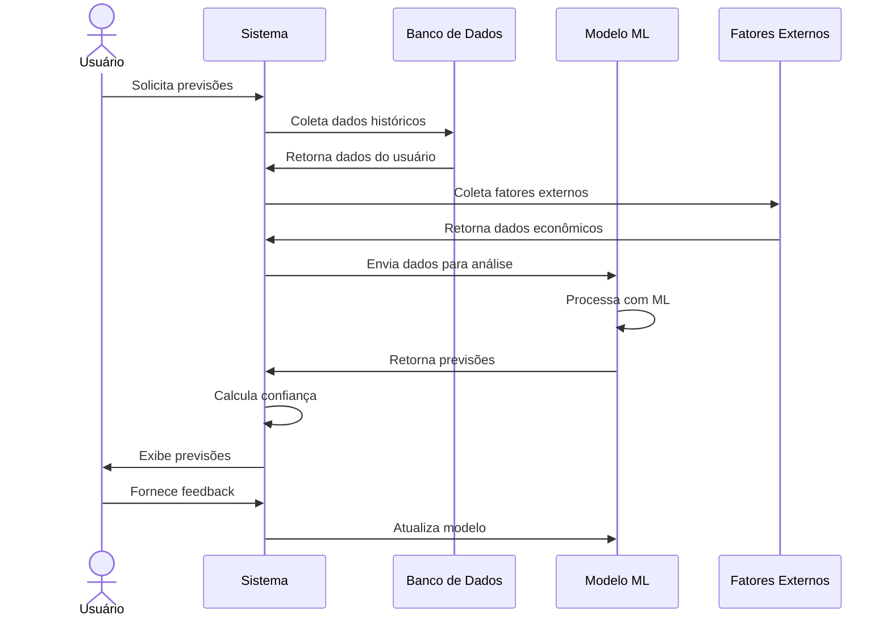

# RF140 🤖 Previsões baseadas em machine learning

## 📝 Descrição

Esta funcionalidade utiliza machine learning para gerar previsões financeiras personalizadas no sistema Metakyasshu, incluindo gastos futuros, receitas esperadas e tendências de comportamento.

## 👥 Atores

- 👤 Usuário autenticado
- 🤖 Sistema de IA

## ⚠️ Pré-condições

- O usuário deve estar autenticado no sistema
- O usuário deve ter histórico mínimo de dados (3 meses)
- O sistema de IA deve estar operacional

## 🔌 Endpoints

- `GET /api/analytics/predictions`
- `POST /api/analytics/predictions/feedback`
- `GET /api/analytics/predictions/accuracy`

## 📋 Parâmetros de Previsão

| Campo         | Tipo      | Obrigatório | Descrição                    | Restrições                    |
|---------------|-----------|-------------|------------------------------|-------------------------------|
| `period`      | `string`  | ✅ Sim       | Período de previsão          | 1m, 3m, 6m, 12m              |
| `categories`  | `array`   | ❌ Não       | Categorias específicas       | Lista de categorias           |
| `confidence`  | `decimal` | ❌ Não       | Nível de confiança mínimo    | Entre 0.1 e 1.0              |
| `factors`     | `array`   | ❌ Não       | Fatores externos             | Inflação, sazonalidade, etc.  |
| `algorithm`   | `string`  | ❌ Não       | Algoritmo específico         | LSTM, ARIMA, Prophet          |
| `updateModel` | `boolean` | ❌ Não       | Atualizar modelo             | Padrão: false                 |

## 🔄 Fluxo Principal



1. O usuário acessa a seção de previsões do sistema.
2. O usuário define o período de previsão desejado (1, 3, 6 ou 12 meses).
3. O sistema coleta dados históricos do usuário (despesas, receitas, padrões).
4. O sistema coleta fatores externos (inflação, sazonalidade, indicadores econômicos).
5. O sistema envia os dados para o modelo de machine learning.
6. O modelo processa os dados usando algoritmos de previsão (LSTM, ARIMA, Prophet).
7. O sistema calcula o nível de confiança das previsões.
8. O sistema exibe as previsões organizadas por categoria e período.
9. O usuário pode fornecer feedback sobre a precisão das previsões.
10. O sistema utiliza o feedback para melhorar o modelo.

## 🔀 Fluxos Alternativos

### ⚠️ FA01 - Previsões com fatores externos

1. O usuário ativa consideração de fatores externos.
2. O sistema coleta dados de inflação, PIB, taxa de juros.
3. O sistema ajusta as previsões com base nos fatores externos.
4. O sistema exibe previsões mais precisas.

### ⚠️ FA02 - Previsões por categoria específica

1. O usuário seleciona categorias específicas para previsão.
2. O sistema foca apenas nas categorias selecionadas.
3. O sistema gera previsões mais detalhadas para essas categorias.
4. O sistema exibe análise de tendências por categoria.

### ⚠️ FA03 - Previsões com diferentes algoritmos

1. O usuário pode escolher entre diferentes algoritmos de ML.
2. O sistema executa previsões com múltiplos algoritmos.
3. O sistema compara os resultados dos diferentes algoritmos.
4. O sistema sugere o algoritmo mais preciso para o usuário.

## 🚫 Fluxos de Exceção

### ⚠️ FE01 - Dados insuficientes

1. Se o usuário não tiver dados suficientes (menos de 3 meses), o sistema exibe aviso.
2. O sistema sugere aguardar mais dados ou usar previsões baseadas em médias.
3. O sistema pode usar dados de usuários similares como referência.

### ⚠️ FE02 - Baixa confiança nas previsões

1. Se o nível de confiança for muito baixo, o sistema exibe aviso.
2. O sistema sugere fatores que podem melhorar a precisão.
3. O sistema pode sugerir ajustes nos parâmetros de previsão.

### ⚠️ FE03 - Erro no modelo de ML

1. Se houver erro no processamento do modelo, o sistema exibe mensagem de erro.
2. O sistema tenta usar modelo de backup ou previsões simplificadas.
3. O sistema registra o erro para correção.

### ⚠️ FE04 - Dados inconsistentes

1. Se houver inconsistências nos dados históricos, o sistema exibe aviso.
2. O sistema sugere verificação e correção dos dados.
3. O sistema pode usar dados limpos para previsões.

## 🧪 Exemplos de Uso

### Requisição de Previsões

```http
GET /api/analytics/predictions?period=3m&confidence=0.8&categories[]=Alimentação&categories[]=Transporte HTTP/1.1
Host: api.metakyasshu.com
Authorization: Bearer {token}
```

### Resposta de Sucesso

```json
{
  "success": true,
  "data": {
    "period": "3m",
    "generatedAt": "2024-12-20T12:30:00Z",
    "confidence": 0.85,
    "algorithm": "LSTM",
    "predictions": {
      "expenses": {
        "total": {
          "month1": 2500.00,
          "month2": 2600.00,
          "month3": 2450.00
        },
        "categories": {
          "Alimentação": {
            "month1": 800.00,
            "month2": 850.00,
            "month3": 780.00,
            "trend": "increasing",
            "confidence": 0.90
          },
          "Transporte": {
            "month1": 400.00,
            "month2": 420.00,
            "month3": 380.00,
            "trend": "stable",
            "confidence": 0.85
          }
        }
      },
      "income": {
        "total": {
          "month1": 5000.00,
          "month2": 5000.00,
          "month3": 5200.00
        }
      },
      "savings": {
        "month1": 2500.00,
        "month2": 2400.00,
        "month3": 2750.00
      }
    },
    "factors": {
      "inflation": 0.05,
      "seasonality": "high",
      "economicIndicators": "stable"
    },
    "insights": [
      "Gastos com alimentação tendem a aumentar no mês 2",
      "Receita esperada de aumento no mês 3",
      "Poupança mantém tendência positiva"
    ]
  }
}
```

### Feedback de Precisão

```http
POST /api/analytics/predictions/feedback HTTP/1.1
Host: api.metakyasshu.com
Authorization: Bearer {token}
Content-Type: application/json

{
  "predictionId": "pred123",
  "actualValue": 820.00,
  "predictedValue": 800.00,
  "category": "Alimentação",
  "period": "2024-01",
  "accuracy": 0.975,
  "feedback": "Previsão muito precisa"
}
```

### Relatório de Precisão

```http
GET /api/analytics/predictions/accuracy HTTP/1.1
Host: api.metakyasshu.com
Authorization: Bearer {token}
```

```json
{
  "accuracy": {
    "overall": 0.87,
    "byCategory": {
      "Alimentação": 0.92,
      "Transporte": 0.85,
      "Moradia": 0.95
    },
    "byAlgorithm": {
      "LSTM": 0.89,
      "ARIMA": 0.84,
      "Prophet": 0.86
    },
    "improvement": 0.05
  }
}
```

---

> ---------------------------------------------------------------------------
> #### 💰 METAKYASSHU 💰
> ***Transformando finanças em conquistas compartilhadas***
> --------------------------------------------------------------------------- 