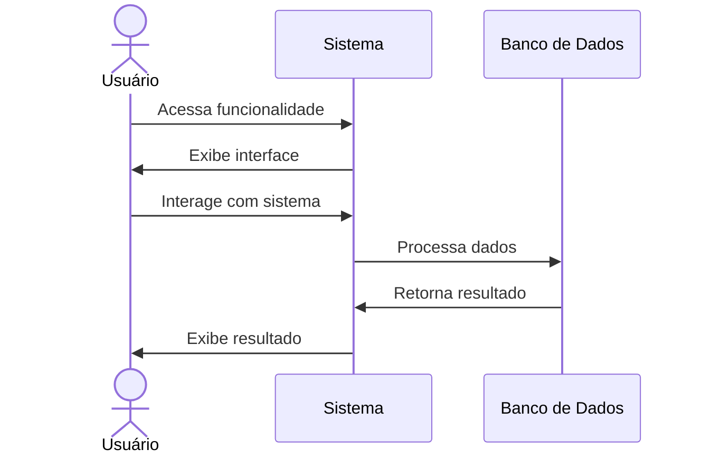

# RF150 📈 Métricas de performance financeira

## 📝 Descrição

Esta funcionalidade permite que usuários métricas de performance financeira no sistema Metakyasshu, fornecendo uma experiência completa e integrada.

## 👥 Atores

- 👤 Usuário autenticado
- 👥 Membro de grupo (se aplicável)

## ⚠️ Pré-condições

- O usuário deve estar autenticado no sistema
- O usuário deve ter permissão para acessar esta funcionalidade

## 🔌 Endpoints

- `GET /api/analytics`
- `POST /api/analytics`
- `PUT /api/analytics/{id}`
- `DELETE /api/analytics/{id}`

## 📋 Dados do Métricas

| Campo           | Tipo     | Obrigatório | Descrição                    | Restrições                    |
|-----------------|----------|-------------|------------------------------|-------------------------------|
| `name`          | `string` | ✅ Sim       | Nome do métricas | Máximo 100 caracteres         |
| `description`   | `text`   | ❌ Não       | Descrição detalhada          | Máximo 500 caracteres         |
| `status`        | `string` | ✅ Sim       | Status atual                 | active, inactive, pending     |
| `createdAt`     | `date`   | ✅ Sim       | Data de criação              | Data válida                   |
| `updatedAt`     | `date`   | ❌ Não       | Data de atualização          | Data válida                   |

## 🔄 Fluxo Principal



1. O usuário acessa a funcionalidade no sistema.
2. O sistema exibe a interface apropriada.
3. O usuário interage com a funcionalidade.
4. O sistema processa os dados informados.
5. O sistema salva as informações no banco de dados.
6. O sistema exibe confirmação da operação.

## 🔀 Fluxos Alternativos

### ⚠️ FA01 - Operação com dados existentes

1. O usuário tenta criar item que já existe.
2. O sistema verifica duplicação.
3. O sistema sugere edição do item existente.
4. O usuário pode editar ou cancelar.

### ⚠️ FA02 - Operação em grupo

1. O usuário seleciona operação em grupo.
2. O sistema verifica permissões.
3. O sistema aplica configurações do grupo.
4. O sistema notifica membros do grupo.

## 🚫 Fluxos de Exceção

### ⚠️ FE01 - Dados inválidos

1. Se os dados informados forem inválidos, o sistema exibe erro.
2. O sistema destaca os campos com problema.
3. O usuário deve corrigir os dados.

### ⚠️ FE02 - Permissão insuficiente

1. Se o usuário não tiver permissão, o sistema exibe erro.
2. O sistema informa permissões necessárias.
3. O usuário deve solicitar permissões.

### ⚠️ FE03 - Erro no sistema

1. Se houver erro técnico, o sistema exibe mensagem.
2. O sistema registra o erro para análise.
3. O usuário pode tentar novamente.

## 🧪 Exemplos de Uso

### Requisição HTTP

```http
GET /api/analytics HTTP/1.1
Host: api.metakyasshu.com
Authorization: Bearer {token}
```

### Resposta de Sucesso

```json
{
  "success": true,
  "data": {
    "id": "item123",
    "name": "Exemplo",
    "description": "Descrição do item",
    "status": "active",
    "createdAt": "2024-12-20T12:30:00Z"
  }
}
```

### Criar Novo Item

```http
POST /api/analytics HTTP/1.1
Host: api.metakyasshu.com
Authorization: Bearer {token}
Content-Type: application/json

{
  "name": "Novo Item",
  "description": "Descrição do novo item",
  "status": "active"
}
```

---

> ---------------------------------------------------------------------------
> #### 💰 METAKYASSHU 💰
> ***Transformando finanças em conquistas compartilhadas***
> ---------------------------------------------------------------------------
